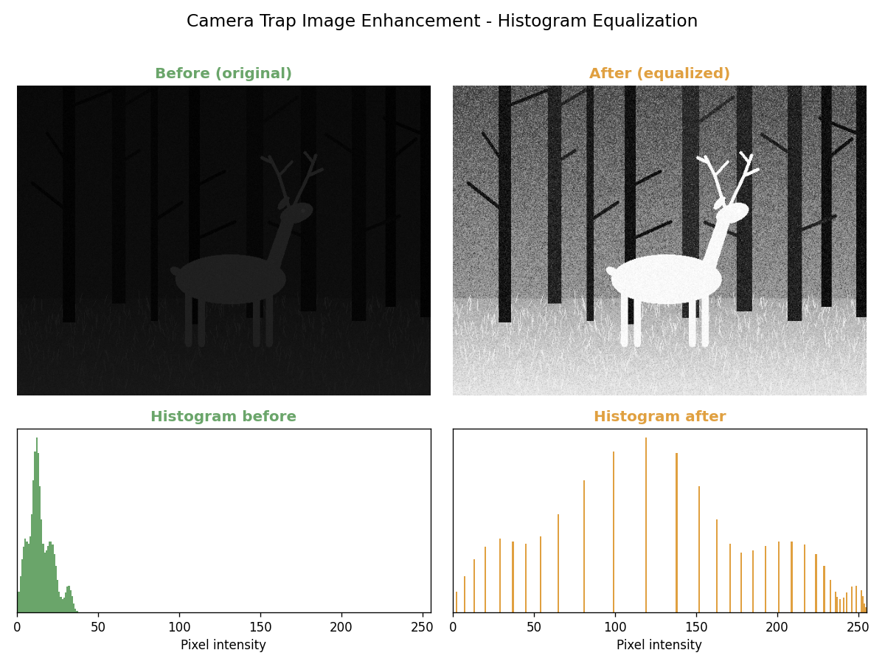

# Camera Trap Image Enhancement

**Course:** CENG376 – Image Processing (term project)

Making night-time wildlife photos visible with **histogram equalization**.



## Problem

Camera traps photograph animals at night with weak infrared flash. Most pixels
end up in a narrow dark band (roughly 0–40 out of 255), so the animal, the
trees and the grass are hard or impossible to see.

## Method

Global histogram equalization remaps pixel intensities through the cumulative
histogram so that they spread over the full 0–255 range. The core of the
method is two OpenCV calls:

```python
img = cv2.imread("deer.jpg", 0)
result = cv2.equalizeHist(img)
```

`src/enhancement.py` wraps these calls with input validation:
`cv2.imread` returns `None` instead of raising on failure, and
`cv2.equalizeHist` accepts only 8-bit single-channel images.

## Project structure

```
camera-trap-enhancement/
├── demo.py                 # before/after comparison figure (headless)
├── src/enhancement.py      # load_grayscale(), equalize_histogram()
├── scripts/make_sample.py  # synthetic dark night scene for offline demos
├── tests/                  # pytest unit tests
└── docs/
    ├── ROADMAP.md          # weekly plan
    └── images/             # figures used in this README
```

## Setup

Requires Python 3.9+.

```bash
git clone https://github.com/yagmustudio/camera-trap-enhancement.git
cd camera-trap-enhancement
python3 -m venv .venv
source .venv/bin/activate
pip install -r requirements.txt
```

## Usage

```bash
# 1. Generate the synthetic dark sample (data/sample/night_deer.png)
python scripts/make_sample.py

# 2. Run the demo -> results/week1_comparison.png
python demo.py

# Use your own photo instead
python demo.py --input deer.jpg --output results/deer_comparison.png
```

The demo uses matplotlib's `Agg` backend, so no display is needed. It also
prints basic statistics, e.g. for the synthetic sample:

```
Before: min=  0  max= 40  mean=  14.3  std=  7.6
After : min=  0  max=255  mean= 131.9  std= 73.3
```

## Tests

```bash
pytest
```

## Roadmap

The project is developed in weekly stages; see [docs/ROADMAP.md](docs/ROADMAP.md).
Each completed week is marked with a Git tag (`week-1`, `week-2`, ...).
